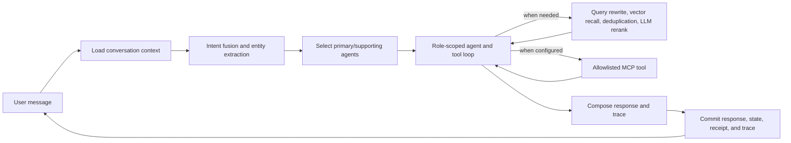
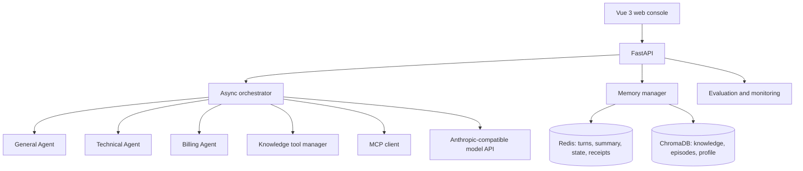

# RelayDesk

[简体中文](README.md) | English

**A multi-agent support desk for technical troubleshooting and billing questions, with tool-based RAG, persistent conversation memory, and MCP integrations.**

RelayDesk is a Python customer-support assistant with a Vue web console. It routes requests to a general, technical, or billing specialist, retrieves relevant knowledge when needed, and carries useful context across turns. Composite requests can dispatch multiple specialists concurrently and compose their responses.

> **Demo boundary:** This portfolio project is not connected to real order, payment, refund, invoice, or ticketing systems. Billing and refund responses explain configured policy; they do not perform transactions or create tickets. Escalation creates a handoff summary, not a live staffed support ticket.

**中文简介：** RelayDesk 是面向技术故障咨询、账单疑问和退款规则问答的多 Agent 客服原型。系统根据意图分配通用、技术或账单 Agent，按需检索知识库并调用受限工具；跨领域问题可以并行处理，多轮会话使用 Redis 与 ChromaDB 保存对话上下文、摘要、情景记忆及用户画像。项目不连接真实订单、支付或工单系统，不执行退款或创建工单。

## Highlights

- **Intent-aware routing:** combines LLM classification, a local character n-gram similarity signal, and keyword patterns. Low-confidence requests can be clarified. This is a routing mechanism, not a trained intent classifier.
- **Agent collaboration:** selects a primary specialist and can dispatch supporting agents concurrently for composite requests. A response composer merges results and has a deterministic fallback.
- **RAG:** chunks knowledge documents into ChromaDB vector search; rewrites queries, runs recall in parallel, deduplicates candidates, and uses the LLM to rerank when needed. The pipeline includes TTL caching, identical-query coalescing, timeouts, and a circuit breaker.
- **MCP:** uses the official Python SDK for configured Streamable HTTP or stdio servers, tool discovery, and role/tool allowlists. The example Microsoft Learn connection is read-only. RelayDesk can also expose its local knowledge tools over MCP.
- **Layered memory:** Redis stores recent messages, summaries, and structured conversation state; ChromaDB stores episodes and user profiles for semantic retrieval. Older turns can be summarized while recent context is retained.
- **Request consistency:** conversation locks, renewable distributed leases, Redis transactions, and request receipts serialize application state and replay a prior response for a repeated request ID. This does not promise exactly-once external side effects.
- **Evaluation and observability:** intent accuracy/macro-F1, four LLM-as-Judge dimensions, deterministic checks for expected agents/intents/tools/entities, request stage timings, token usage, and tool traces.
- **Web console:** Vue 3 interface for chat, knowledge import/search, evaluation jobs, health/monitoring, and trace inspection.

## Request flow



## Architecture



### Key implementation paths

| Path | Responsibility |
| --- | --- |
| `backend/api/main.py` | FastAPI lifecycle, chat, knowledge, evaluation, and monitoring endpoints |
| `backend/core/intent_recognizer.py` | Intent signals, confidence handling, entity extraction |
| `backend/agents/agent_orchestrator.py` | Specialist routing, parallel execution, tool loop, response composition |
| `backend/tooling/knowledge_base.py` | Document chunking and ChromaDB knowledge search |
| `backend/tooling/tool_manager.py` | Query rewriting, concurrent recall, deduplication, reranking, cache, and circuit breaker |
| `backend/tooling/mcp_client.py` | MCP transport and configured server/tool access |
| `backend/core/skill_loader.py` | Role/keyword-aware business Skills and runtime reload |
| `backend/memory/conversation_memory.py` | Redis/ChromaDB memory, compression, and atomic turn commits |
| `backend/evaluation/` | Intent and dialogue evaluation |
| `frontend/` | Vue 3 web interface |

### Intent signals

The default decision combines LLM classification, a 256-dimensional hashed character n-gram vector, and keyword patterns. An optional hosted embedding provider can replace the local embedding signal. Low-confidence input can trigger a clarifying question.

### RAG pipeline

1. Rewrite a query into up to three related searches.
2. Run ChromaDB vector retrieval concurrently.
3. Merge and deduplicate candidates by document/content identity.
4. Ask the configured language model to rerank when there are more candidates than the requested top-k.
5. Cache successful results and apply timeout/failure handling.

This implementation uses vector retrieval and LLM reranking. It does not implement BM25, Reciprocal Rank Fusion, or Cross-Encoder reranking.

### Memory and replay handling

Recent messages, compressed summaries, structured slots, and request receipts are isolated by user/conversation. ChromaDB contributes semantically related prior episodes and a user profile. A Redis transaction commits the turn's messages, response receipt, state, and tool trace. Replay protection covers RelayDesk's application lifecycle; it cannot guarantee exactly-once effects in a third-party system.

## Technology

- Backend: Python 3.12, FastAPI, Pydantic, asyncio, Anthropic SDK, Redis, ChromaDB, official MCP SDK, Prometheus client.
- Frontend: Vue 3, Vite, JavaScript, Node.js 22.
- Services: Docker Compose, Redis, ChromaDB, Nginx, Prometheus.
- Tests: pytest, pytest-asyncio, fakeredis, Node built-in test runner.

## Quick start: Docker Compose

### Requirements
- An API key for an Anthropic Messages-compatible provider. DeepSeek's Anthropic-compatible endpoint is the tested configuration.
- Internet access on first build for images, dependencies, and ChromaDB's default local embedding model.

### Start

```bash
git clone https://github.com/BZhXuang/RelayDesk-Customer-Service-Agent.git
cd RelayDesk-Customer-Service-Agent
cp .env.example .env
```

Edit `.env`. Set `ANTHROPIC_API_KEY` to your own provider key and `REDIS_PASSWORD` to a long random URL-safe value. Start the stack:

```bash
docker compose up --build -d
```

Open the web console at http://localhost:5173, API docs at http://localhost:8000/docs, health at http://localhost:8000/health, or Prometheus at http://localhost:9090.

Compose binds the API to loopback. Named volumes preserve Redis, ChromaDB, application, and Prometheus data. Stop services with `docker compose down`. Adding `-v` removes the data volumes too.

### Configure the model

```dotenv
ANTHROPIC_API_KEY=your-own-key
ANTHROPIC_BASE_URL=https://api.deepseek.com/anthropic
ANTHROPIC_MODEL=deepseek-v4-pro
```

The selected provider/model must support the Anthropic Messages API and tool calling. Keep the model key on the backend; never embed it in frontend assets.

## Local development without Docker

Install Python 3.12, Node.js 22+, Redis, and ChromaDB. From the repository root:

```bash
python -m venv .venv
# Windows PowerShell: .venv\Scripts\Activate.ps1
# macOS/Linux:       source .venv/bin/activate
python -m pip install -r backend/requirements-dev.txt
```

Create `backend/.env` with your own provider key and local storage endpoints:

```dotenv
ANTHROPIC_API_KEY=your-own-key
ANTHROPIC_BASE_URL=https://api.deepseek.com/anthropic
ANTHROPIC_MODEL=deepseek-v4-pro
REDIS_URL=redis://localhost:6379/0
CHROMA_HOST=localhost
CHROMA_PORT=8000
CHROMA_PERSIST_DIRECTORY=./data/chroma
RELAYDESK_ENV=development
```

From `backend/`, run:

```bash
python -m uvicorn api.main:app --host 127.0.0.1 --port 8000 --reload
```

Then from another terminal:

```bash
cd frontend
npm ci
npm run dev
```

Vite proxies `/api/python/*` to the local API. Model-backed chat, evaluation, memory compression, and reranking may incur provider usage charges.

## Configuration

The checked-in `.env.example` contains placeholders only. Root/backend `.env` files, generated data, and logs are ignored by Git.

| Variable | Purpose |
| --- | --- |
| `ANTHROPIC_API_KEY` | Provider key for chat, intent reasoning, summaries, reranking, and evaluation |
| `ANTHROPIC_BASE_URL` | Anthropic-compatible endpoint; DeepSeek example: `https://api.deepseek.com/anthropic` |
| `ANTHROPIC_MODEL` | Model identifier, e.g. `deepseek-v4-pro` |
| `REDIS_PASSWORD` | Required Compose Redis password; use a long URL-safe random value |
| `REDIS_URL` | Redis URL for standalone backend development |
| `CHROMA_HOST` / `CHROMA_PORT` | ChromaDB endpoint; Compose configures the internal service |
| `CHROMA_PERSIST_DIRECTORY` | Local ChromaDB fallback path |
| `RELAYDESK_ENV` | `development` for a local demo; `production` requires bearer tokens |
| `RELAYDESK_API_TOKENS` | JSON mapping of bearer tokens to user IDs and `user`/`admin` roles |
| `MCP_EXTERNAL_ENABLED` | Set to `false` to disable external MCP connections |
| `INTENT_EMBEDDING_PROVIDER` | Intent vector provider; local n-gram requires no extra key |
| `SILICONFLOW_API_KEY` | Optional separate hosted embedding credential; never reuse the model key |
| `API_PORT` / `FRONTEND_PORT` / `PROMETHEUS_UI_PORT` | Local service ports |

## Evaluation and verification

Run checks from the repository root:

```bash
cd backend
python -m pytest tests -q
cd ../frontend
npm ci
npm test
npm run build
```

The cleaned RelayDesk snapshot passes **165 backend tests**, **14 frontend tests**, and a frontend production build. The suites include mocks and regression cases; these counts are not live conversations, benchmark accuracy, a user study, or evidence of production capacity. The Docker image was not rebuilt during this cleanup.

Separate online smoke checks previously exercised a real DeepSeek chat, technical-question routing, refund-policy knowledge retrieval, request replay, tool traces, and memory restoration after a restart. Live-provider checks need your own key and may incur charges.

The in-app evaluator reports intent accuracy/macro-F1 and can score relevance, accuracy, completeness, and helpfulness with an LLM Judge. Deterministic checks can assert the selected agent/intent, required tools, and expected entities. Evaluation scope is the orchestrator; HTTP authentication, storage lifecycle, and replay receipts have separate API/storage regression tests.

## API endpoints

| Endpoint | Purpose |
| --- | --- |
| `GET /health` | Readiness |
| `POST /chat` | Multi-turn chat; accepts message, user ID, optional conversation ID and request ID |
| `POST /search` | Search the local knowledge base |
| `GET /knowledge/stats` | Knowledge collection statistics |
| `POST /knowledge/add`, `POST /knowledge/upload` | Add text documents or upload supported files |
| `GET /skills`, `POST /skills/reload` | Inspect/reload business Skills |
| `GET /trace/tool/{request_id}` | Inspect a tool-call trace |
| `POST /eval/run`, `GET /eval/jobs/{job_id}` | Start and poll evaluations |
| `GET /monitor`, `GET /metrics` | Monitoring summary and Prometheus metrics |
| `/mcp/` | Standard MCP endpoint for local knowledge tools |

See `/docs` for exact request and response schemas.

## Security and project boundaries

- Never commit `.env` files, provider keys, bearer tokens, Redis dumps, ChromaDB databases, logs, generated evaluation output, or real user conversations.
- Compose publishes the API only on `127.0.0.1`. Development mode has no user authentication; do not expose it to untrusted networks.
- Before network-exposed deployment, set `RELAYDESK_ENV=production`, configure independent high-entropy `RELAYDESK_API_TOKENS`, store secrets in a platform secret manager, terminate TLS at a trusted proxy, and review CORS and MCP host/origin allowlists.
- Compose requires a user-supplied Redis password. Do not use a demo credential for deployment.
- Treat MCP results as untrusted input. Review server URLs, enabled tools, and permitted agent roles.
- Tools are deliberately bounded. There is no live order/payment/refund/ticket system or staffed human-service queue.
- ChromaDB uses its default local `all-MiniLM-L6-v2` model for knowledge/memory search; intent vectors use a separate local character n-gram implementation.
- No license file is included. Public visibility alone does not grant reuse rights; add a license only when authorized.

## Repository layout

```text
backend/
  agents/       Agent runtime and tool policy
  api/          FastAPI application
  core/         Intent, state, concurrency, Skills, instrumentation
  evaluation/   Intent/dialogue evaluation
  memory/       Redis and ChromaDB conversation memory
  monitor/      Performance monitoring
  skills/       Role-specific Markdown rules
  tests/        Regression and integration tests
  tooling/      RAG, tool management, MCP
frontend/       Vue 3 web console and tests
monitoring/     Prometheus scrape configuration
docker-compose.yml
.env.example
```

## License

No license file is currently included; all rights remain with the respective rights holders.

