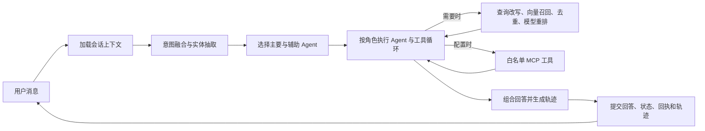

# RelayDesk

[English](README.md) | 简体中文

**面向技术支持与账单咨询的多 Agent 客服原型，包含知识检索、跨轮会话记忆、受限工具调用和 MCP 集成。**RelayDesk 由 Python/FastAPI 后端和 Vue 3 控制台组成，可根据请求意图选择通用、技术或账单 Agent；复合问题可以并行调度多个 Agent，再组合回答。

系统按需检索项目知识库，并由配置的模型处理意图判断、查询改写、候选重排和回答生成。Redis 保存近期对话、摘要和结构化状态；ChromaDB 用于知识检索，以及相关历史情景和用户画像的语义检索。MCP 客户端支持配置的 Streamable HTTP 或 stdio 服务，并按 Agent 角色和工具白名单限制调用。

> **演示边界：** 这是作品集项目，不连接真实订单、支付、退款、发票或工单系统。账单与退款回复只解释配置的规则，不会执行交易或创建工单；升级处理只生成交接摘要，不会创建有客服人员跟进的工单。

## 功能概览

- **意图识别与路由：** 综合语言模型分类、本地字符 n-gram 相似度和关键词规则；低置信度请求可以触发澄清。这是路由机制，不是训练得到的意图分类器。
- **多 Agent 协作：** 选择主要处理 Agent；复合请求可并行调用辅助 Agent，再组合结果，并提供确定性回退逻辑。
- **知识检索（RAG）：** 将知识文档分块后写入 ChromaDB；检索时进行查询改写、并发召回、候选去重，并在需要时用配置的语言模型重排。实现还包含 TTL 缓存、相同查询合并、超时控制和熔断器。
- **MCP 工具：** 使用官方 Python SDK 连接已配置的 Streamable HTTP 或 stdio MCP 服务，发现工具并执行角色/工具白名单检查。示例中的 Microsoft Learn 连接为只读；RelayDesk 也能通过 MCP 暴露本地知识工具。
- **分层会话记忆：** Redis 保存近期消息、摘要和结构化会话状态；ChromaDB 保存历史情景及用户画像，以便语义检索。较早的对话轮次可压缩为摘要，同时保留近期上下文。
- **请求一致性：** 使用会话锁、可续租的分布式租约、Redis 事务和请求回执串行化应用状态；重复请求 ID 可复用之前的响应。这不保证第三方系统中的副作用恰好执行一次。
- **评估与观测：** 支持意图准确率和宏平均 F1、四个维度的 LLM-as-Judge、对预期 Agent/意图/工具/实体的确定性检查，以及请求阶段耗时、Token 用量和工具调用轨迹。
- **Web 控制台：** Vue 3 界面提供对话、知识导入与搜索、评估任务、健康状态与监控、调用轨迹查看。

## 请求处理流程



## 架构与关键代码

| 路径 | 职责 |
| --- | --- |
| `backend/api/main.py` | FastAPI 生命周期、对话、知识库、评估和监控 API |
| `backend/core/intent_recognizer.py` | 意图信号、置信度处理和实体抽取 |
| `backend/agents/agent_orchestrator.py` | 专家 Agent 路由、并行执行、工具循环和回答组合 |
| `backend/tooling/knowledge_base.py` | 文档分块和 ChromaDB 知识检索 |
| `backend/tooling/tool_manager.py` | 查询改写、并发召回、去重、重排、缓存和熔断器 |
| `backend/tooling/mcp_client.py` | MCP 传输和已配置的服务/工具访问 |
| `backend/core/skill_loader.py` | 按角色和关键词选择业务 Skill，并支持运行时重载 |
| `backend/memory/conversation_memory.py` | Redis/ChromaDB 记忆、上下文压缩和原子提交对话轮次 |
| `backend/evaluation/` | 意图与对话评估 |
| `frontend/` | Vue 3 Web 控制台 |

意图判断默认结合模型分类、256 维哈希字符 n-gram 向量和关键词规则；可选的托管 Embedding 服务可以替换本地向量信号。低置信度输入可以触发澄清问题。

RAG 流程会将查询改写为最多三个相关搜索，并发执行 ChromaDB 向量检索，按文档/内容标识合并去重候选；当候选多于请求的 top-k 时，可调用配置的语言模型重排。成功结果会缓存，并实施超时和失败处理。当前实现**不包含 BM25、RRF 或 Cross-Encoder 重排**。

近期消息、压缩摘要、结构化槽位和请求回执按用户/会话隔离。ChromaDB 提供语义相关的历史情景和用户画像。Redis 事务提交消息、响应回执、状态和工具轨迹。重放保护覆盖 RelayDesk 应用生命周期，不保证第三方系统中的副作用恰好执行一次。

## 技术栈

- 后端：Python 3.12、FastAPI、Pydantic、asyncio、Anthropic SDK、Redis、ChromaDB、官方 MCP SDK、Prometheus client。
- 前端：Vue 3、Vite、JavaScript、Node.js 22。
- 服务：Docker Compose、Redis、ChromaDB、Nginx、Prometheus。
- 测试：pytest、pytest-asyncio、fakeredis、Node 内置测试运行器。

## Docker Compose 快速启动

需要一个兼容 Anthropic Messages API 的模型服务商密钥。DeepSeek 的 Anthropic 兼容端点是已测试的配置。首次构建需要联网拉取镜像、依赖和 ChromaDB 默认本地 Embedding 模型。

```bash
git clone https://github.com/BZhXuang/RelayDesk-Customer-Service-Agent.git
cd RelayDesk-Customer-Service-Agent
cp .env.example .env
```

编辑 `.env`：将 `ANTHROPIC_API_KEY` 设置为你自己的服务商密钥，并将 `REDIS_PASSWORD` 设置为较长的随机 URL-safe 字符串。启动服务：

```bash
docker compose up --build -d
```

访问地址：Web 控制台 `http://localhost:5173`；API 文档 `http://localhost:8000/docs`；健康检查 `http://localhost:8000/health`；Prometheus `http://localhost:9090`。

Compose 将 API 绑定到本机回环地址。命名卷保存 Redis、ChromaDB、应用和 Prometheus 数据。使用 `docker compose down` 停止服务；添加 `-v` 会同时删除数据卷。

模型配置示例：

```dotenv
ANTHROPIC_API_KEY=your-own-key
ANTHROPIC_BASE_URL=https://api.deepseek.com/anthropic
ANTHROPIC_MODEL=deepseek-v4-pro
```

所选服务商和模型需支持 Anthropic Messages API 与工具调用。密钥只保存在后端环境变量中，不要写入前端资源。

## 不使用 Docker 的本地开发

安装 Python 3.12、Node.js 22+、Redis 和 ChromaDB。在仓库根目录运行：

```bash
python -m venv .venv
# Windows PowerShell: .venv\Scripts\Activate.ps1
# macOS/Linux:       source .venv/bin/activate
python -m pip install -r backend/requirements-dev.txt
```

在 `backend/.env` 中配置自己的服务商密钥和本地存储地址：

```dotenv
ANTHROPIC_API_KEY=your-own-key
ANTHROPIC_BASE_URL=https://api.deepseek.com/anthropic
ANTHROPIC_MODEL=deepseek-v4-pro
REDIS_URL=redis://localhost:6379/0
CHROMA_HOST=localhost
CHROMA_PORT=8000
CHROMA_PERSIST_DIRECTORY=./data/chroma
RELAYDESK_ENV=development
```

在 `backend/` 目录启动 API：

```bash
python -m uvicorn api.main:app --host 127.0.0.1 --port 8000 --reload
```

另开终端启动前端：

```bash
cd frontend
npm ci
npm run dev
```

Vite 会将 `/api/python/*` 代理到本地 API。模型对话、评估、记忆压缩和重排可能产生服务商费用。

## 配置项

仓库中的 `.env.example` 只有占位值。根目录和 `backend/` 下的 `.env`、生成数据与日志均由 Git 忽略。

| 变量 | 用途 |
| --- | --- |
| `ANTHROPIC_API_KEY` | 对话、意图推理、摘要、重排和评估所用的服务商密钥 |
| `ANTHROPIC_BASE_URL` | Anthropic 兼容端点；DeepSeek 示例：`https://api.deepseek.com/anthropic` |
| `ANTHROPIC_MODEL` | 模型标识，例如 `deepseek-v4-pro` |
| `REDIS_PASSWORD` | Compose 所需的 Redis 密码；使用较长的随机 URL-safe 值 |
| `REDIS_URL` | 独立运行后端时的 Redis 地址 |
| `CHROMA_HOST` / `CHROMA_PORT` | ChromaDB 地址；Compose 会配置内部服务 |
| `CHROMA_PERSIST_DIRECTORY` | 本地 ChromaDB 回退存储路径 |
| `RELAYDESK_ENV` | 本地演示使用 `development`；`production` 要求 Bearer Token |
| `RELAYDESK_API_TOKENS` | Bearer Token 到用户 ID 及 `user`/`admin` 角色的 JSON 映射 |
| `MCP_EXTERNAL_ENABLED` | 设为 `false` 可禁用外部 MCP 连接 |
| `INTENT_EMBEDDING_PROVIDER` | 意图向量服务商；本地 n-gram 无需额外密钥 |
| `SILICONFLOW_API_KEY` | 可选的托管 Embedding 凭据；不可复用模型密钥 |
| `API_PORT` / `FRONTEND_PORT` / `PROMETHEUS_UI_PORT` | 本地服务端口 |

## 评估与验证

在仓库根目录运行：

```bash
cd backend
python -m pytest tests -q
cd ../frontend
npm ci
npm test
npm run build
```

当前整理后的快照通过了 **165 项后端测试、14 项前端测试和前端生产构建**。测试包含 Mock 与回归用例；这些数量不代表真实对话量、基准准确率、用户研究或生产容量。本次整理没有重新构建 Docker 镜像。

此前的独立在线冒烟检查使用真实 DeepSeek 服务，覆盖了对话、技术问题路由、退款政策知识检索、请求重放、工具轨迹以及重启后的记忆恢复。在线服务检查需要你自己的密钥，并可能产生费用。

内置评估器报告意图准确率/宏平均 F1，并可由 LLM Judge 评价相关性、准确性、完整性和帮助程度。确定性检查可断言所选 Agent/意图、必需工具和预期实体。评估器覆盖编排器；HTTP 鉴权、存储生命周期和请求回执另有 API/存储回归测试。

## API 端点

| 端点 | 用途 |
| --- | --- |
| `GET /health` | 就绪状态 |
| `POST /chat` | 多轮对话；接收消息、用户 ID、可选会话 ID 和请求 ID |
| `POST /search` | 搜索本地知识库 |
| `GET /knowledge/stats` | 知识集合统计 |
| `POST /knowledge/add`、`POST /knowledge/upload` | 添加文本或上传支持的文件 |
| `GET /skills`、`POST /skills/reload` | 查看/重载业务 Skill |
| `GET /trace/tool/{request_id}` | 查看工具调用轨迹 |
| `POST /eval/run`、`GET /eval/jobs/{job_id}` | 启动并查询评估任务 |
| `GET /monitor`、`GET /metrics` | 监控摘要和 Prometheus 指标 |
| `/mcp/` | 本地知识工具的标准 MCP 端点 |

请求和响应的精确结构请查看 `/docs`。

## 安全与项目边界

- 不要提交 `.env` 文件、服务商密钥、Bearer Token、Redis dump、ChromaDB 数据库、日志、生成的评估输出或真实用户对话。
- Compose 只在 `127.0.0.1` 发布 API。开发模式没有用户鉴权，不要将其暴露到不可信网络。
- 若要部署到可从网络访问的环境，应设置 `RELAYDESK_ENV=production`，配置独立且高熵的 `RELAYDESK_API_TOKENS`，将密钥存入平台密钥管理服务，在可信代理处终止 TLS，并检查 CORS 与 MCP 主机/来源白名单。
- Compose 要求用户自行设置 Redis 密码；不要在部署中使用演示密码。
- MCP 返回内容应视为不可信输入。请检查服务器 URL、启用的工具和允许调用的 Agent 角色。
- 工具权限有意受到限制。项目没有真实订单、支付、退款、工单系统或人工客服队列。
- ChromaDB 知识/记忆检索默认使用本地 `all-MiniLM-L6-v2` 模型；意图向量使用单独的本地字符 n-gram 实现。
- 仓库当前不含许可证文件。公开可见不代表授予复用权；请仅在获得授权后添加许可证。

## 许可证

当前未包含许可证文件；相关权利仍归各自权利人所有。
